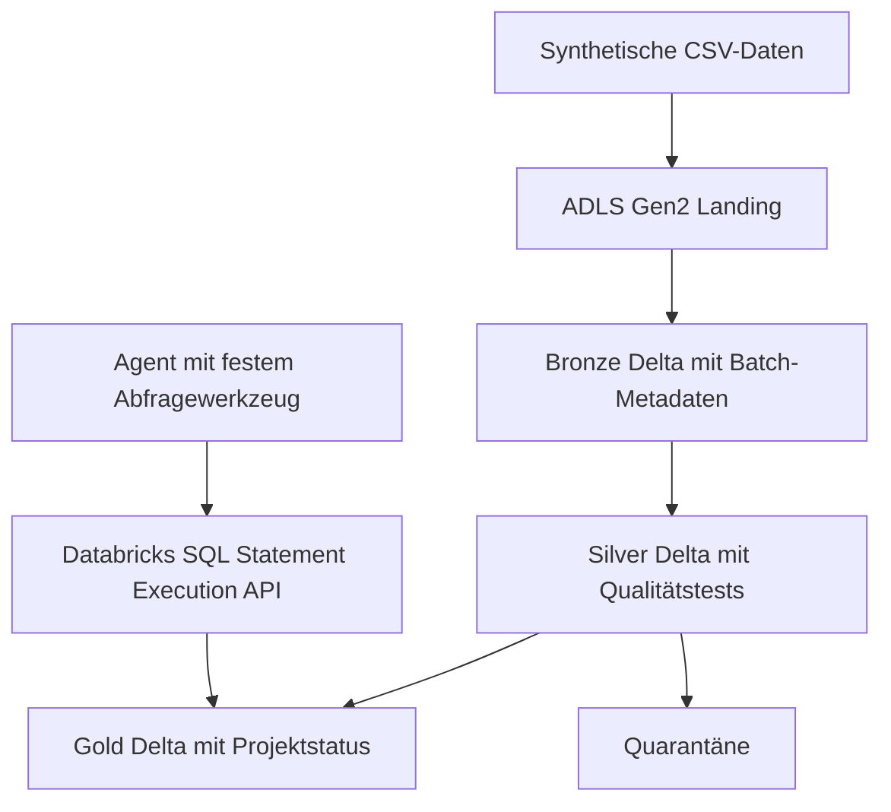

# Architektur

Die mit der Lehrkraft abgestimmte Basis ist eine PMS-Datenplattform auf Azure Databricks. Für das Studienprojekt simulieren CSV-Dateien die fachlichen Eingaben aus Projekt-, ERP- und CRM-Systemen. Die erste Demo verfolgt einen Projektstatus vom Import bis zur Antwort des Agenten.

| Baustein | Aufgabe im MVP |
| --- | --- |
| Azure und Databricks Terraform Provider | Azure-Ressourcen und verwaltbare Databricks-Objekte reproduzierbar bereitstellen. Bootstrap und benötigte Konto-Berechtigungen dokumentieren. |
| ADLS Gen2 | Rohdateien mit Batch-ID ablegen und Speicher für das Lakehouse bereitstellen. Terraform-State separat halten. |
| Lakeflow Jobs | Schritte für Ingestion und Transformation in fester Reihenfolge nachts ausführen und die Laufhistorie kontrollieren. |
| Bronze / Silver / Gold | Rohdaten mit Herkunft sichern. Daten typisieren, deduplizieren und Fehler isolieren. Die Projektstatus-Abfrage aus Gold beantworten. |
| Unity Catalog | Zugriff auf Daten über Katalog, Schema und Objektberechtigungen steuern. |
| GitHub Actions | Reproduzierbare Validierung und später optional authentifiziertes Deployment mittels OIDC, sobald der lokale Ablauf steht. |

## Änderung am Agent-Pfad

Der Agent greift laut Rückmeldung der Lehrkraft direkt über die Databricks-API auf eine Gold-Tabelle zu. Das Agent-Werkzeug sendet eine feste, parametrisierte SELECT-Abfrage an die SQL Statement Execution API. Ein SQL Warehouse führt sie aus. Die eigene Dienstidentität des Agenten erhält die erforderlichen Workspace-/SQL-Berechtigungen, `CAN USE` für das Warehouse und `USE CATALOG`, `USE SCHEMA` und `SELECT` für die vorgesehene Tabelle.

Der vorhandene Entwurf zeigt Azure Functions als Zwischenstation. Für diesen Agent-Leseweg entfällt sie. Die ursprüngliche Idee, Checkpoints mit menschlicher Freigabe und Audit zu schreiben, bleibt als Erweiterung dokumentiert. Ob die Kursanforderung einen Schreib-Demoablauf umfasst, ist noch zu klären. Power BI, PMS-Dashboard und Anbindung echter Quellsysteme sind mögliche spätere Ausbaustufen.

- [Azure Databricks SQL Statement Execution API](https://learn.microsoft.com/en-us/azure/databricks/dev-tools/sql-execution-tutorial)
- [Unity Catalog und Warehouse-Berechtigungen](https://learn.microsoft.com/en-us/azure/databricks/security/auth/rbac/get-started)
